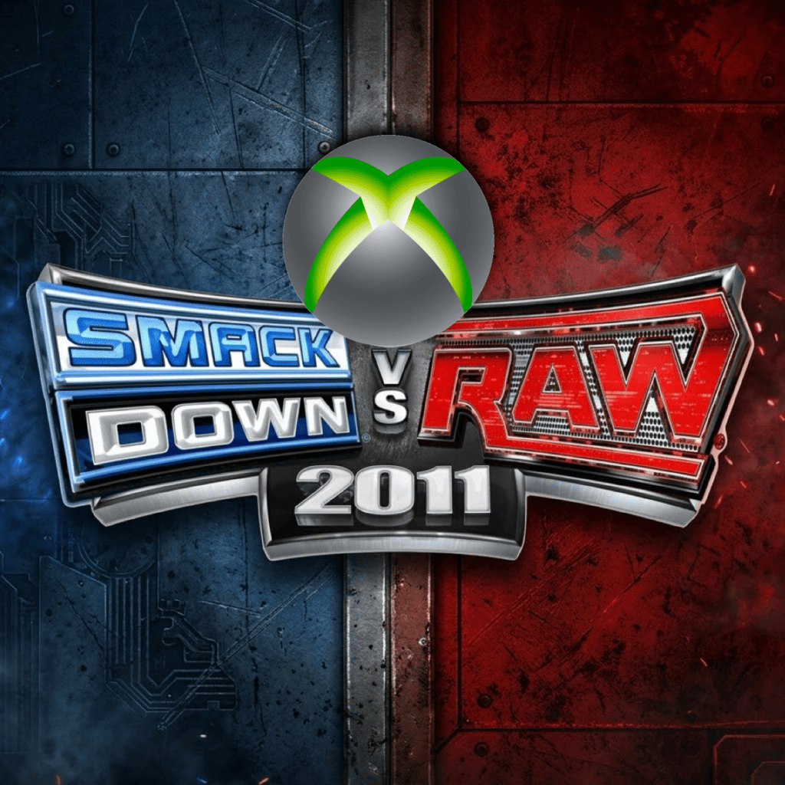
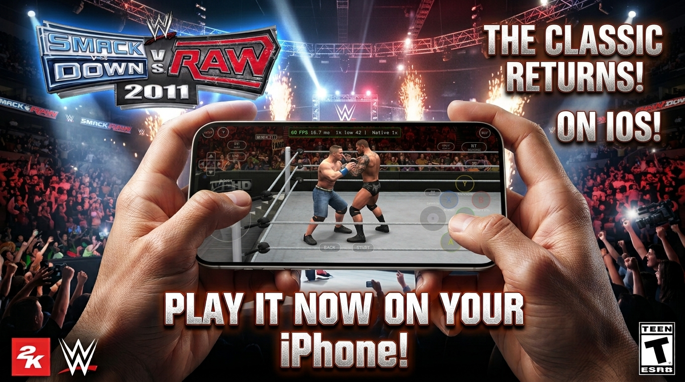

<h1 align="center">WWE SmackDown vs. Raw 2011 — iOS Port</h1>

  

This is an unofficial iOS port of the 2010 Xbox 360 game *WWE SmackDown vs. Raw 2011*. It builds upon [KaikoClanworth1's original PC port](https://github.com/KaikoClanworth1/wwe-svr2011-pc) and is not a traditional emulator. The game's code is statically recompiled into C++ using the [ReXGlue SDK](https://github.com/rexglue/rexglue-sdk) and built into an iOS application. It runs on the SDK's Xenia-derived runtime and uses the Android port's native renderer with Vulkan, translated to Apple's Metal graphics API through [MoltenVK](https://github.com/KhronosGroup/MoltenVK).

 

  

> [!IMPORTANT]
> **This repository has no game in it.** It holds no disc image, XEX, game data, movies, music or recompiled game code. You need your **own copy of the Xbox 360 game**.

> [!NOTE]
> **This is a fork of the original port for Windows/Linux/Android.** The game-side work (the recompilation, the native renderer, the saves, the menus and most features) is KaikoClanworth1's. This fork adds the iOS layer: the memory fixes, the Apple build, the app and the touch setup. See [Credits](#credits). For anything the two ports share, the [original README](https://github.com/KaikoClanworth1/wwe-svr2011-pc#readme) is the full reference.

---

## Status

Tested on an **iPhone 15 Pro (Apple A17 Pro chip)**, running inside LiveContainer / sideloaded via SideStore:

- Menus, character select, entrances and matches all work, at 60 fps in testing.
- On-screen touch controls, which you can rearrange.
- A launcher screen shows before the game starts.
- Saves are plain files in the game folder.
- On the iPhone's wide screen, matches and entrances fill the whole screen.

Other iPhones and iPads haven't been tested. It's an early port, so expect rough edges. See [What carries over from the OG port](#what-carries-over-from-the-og-port) for what is and isn't available.

---

## Contents

- [Status](#status)
- [What you need](#what-you-need)
- [Install and play](#install-and-play)
- [Controls](#controls)
- [Settings](#settings)
- [What carries over from the OG port](#what-carries-over-from-the-og-port)
- [Building from source](#building-from-source)
- [Troubleshooting](#troubleshooting)
- [Credits](#credits)
- [Legal](#legal)

---

## What you need

| | |
|---|---|
| 💿 **The game** | Your own copy of the *WWE SmackDown vs. Raw 2011* **Xbox 360** game, extracted to a folder that contains `default.xex`. You'll usually start from a disc image (`.iso`) and extract it on a PC first. The app doesn't read an `.iso` directly. The PS3, Wii, PS2 and PSP versions won't work. <!-- TODO(author): name the tool or steps you use to extract the ISO. --> |
| 📱 **iPhone** | Tested on an iPhone 15 Pro. The app is built as an iPhone app for **iOS 17 or later** and runs in **landscape**. Other devices are untested, and older or lower-memory ones may not run it. |
| 💾 **Storage** | About 6 GB: 5.3 GB for the game, plus room for saves and caches. |
| 🔧 **A way to sideload** | This can't go on the App Store. Use AltStore, SideStore, LiveContainer, or any tool that installs an IPA. It has been tested through LiveContainer. The game doesn't generate code at run time, so **JIT isn't needed**. |
| 🎮 **Controller** | Optional. The on-screen touch controls work without one. |

---

## Install and play

1. **Get the app.**
   - **Option A: download the IPA** from [**Releases**](https://github.com/Ke619/wwe-svr2011-ios/releases/latest). It holds no game data, but it does contain code generated from the game's executable, so download it only if you own the game.
   - **Option B: build it yourself.** See [Building from source](#building-from-source). This keeps all game-derived code on your own machine.

2. **Install it with your sideloading tool.** Add the IPA in AltStore, SideStore or LiveContainer, and follow that tool's steps. Apps signed with a free Apple ID usually expire after 7 days, and need refreshing in your tool.

3. **Put the game on the phone.** The app plays from an extracted game folder that it looks for in its own **Documents** folder.
   *Method1 :*
   1. On a PC, extract your disc image so you have a folder containing `default.xex` and the rest of the game files.
   2. Copy the contents of that folder into the app's **Documents** folder with the Files app (file sharing is turned on for the app). `default.xex` must sit **directly** in `Documents`, not in a subfolder. 
   3. It's about 5.3 GB, so the copy takes a while.
   *Method 2:*
   - use the built-in install feature in the game launcher to add the game files directly from your ISO dump.

   You don't need to supply shaders. They ship inside the app and are copied into `Documents/native_shaders/` on start-up.

4. **Start the app and play.** The launcher's **Play** tab should say the game files and shaders were found. Press **PLAY**. The first launch creates the settings file.

**Updating:** install the new IPA over the old one. Your saves are in the game folder inside the app.

---

## Controls

**On-screen controls.** The menus get a simple pad: D-pad, A/B/X/Y, bumpers (LB/RB), triggers (LT/RT), and Back and Start. **MENU** (top left) and **EDIT** (top right) are always there. **EDIT** lets you move and resize the controls. Your layout is saved in `UserData/touch_layout.txt` in the game folder.

iOS uses the same touch-control system as the PC port's Android build, so the match controls and the layout editor work the same way. The original README describes them in its [Android section](https://github.com/KaikoClanworth1/wwe-svr2011-pc#android).

**Physical controller.**

The game's main menu has an **EXIT** entry at the bottom.

---

## Settings

Open **My WWE → Options → Graphics** in the game. It has two tabs (**LB / RB**). **Display** holds the basics. **Quality** trades looks for speed, and its changes apply at once.

| Quality setting | What it does |
|---|---|
| **Render resolution** | The most the game renders at. Lower is faster. |
| **Anti-aliasing** | Smoother edges, at a cost in speed. |
| **Textures** | **High**: as the game has them. **Medium** / **Low**: big textures use the game's own half / quarter-size versions, which saves memory and loading time. Menus and fonts stay sharp. |
| **Shadows & effects** | **High**: at the render resolution. **Normal**: at the Xbox 360's size, much less GPU work. |
| **Entrance frame rate** | **60 fps**, or **30 fps** as on the Xbox 360. Entrances and cutscenes then need half the work. |
| **Wide screens** | **Full width**: on wide screens, matches and entrances fill the screen with a wider view. The HUD and menus stay 16:9. **16:9** keeps the original picture with bars. |

**Renderer.** The iOS build uses the **Native** renderer only (Vulkan through MoltenVK). There's no Emulated fallback, as there is on the PC.

Settings are saved in `svr2011.toml` in the game folder (the app's **Documents**). The launcher's **Settings** tab edits the same file.

---

## What carries over from the OG port

| Feature | On iOS |
|---|---|
| Native renderer, 60 fps | ✅ Working |
| Touch controls | ✅ Working |
| Saves as plain files | ✅ Working |
| Wide-screen matches and entrances | ✅ Working |
| Up to 10 HD logos per superstar | ❌ Not available on iOS yet |
| Entrance movies | ❌ Not available on iOS yet |
| DLC | ✅ Working |
| Mods (`.svrmod`) | ❌ Not available on iOS yet |
| Texture packs | ❌ Not available on iOS yet |
| Achievements | ❌ Not available on iOS yet |
| Entrance music from your own songs | ❌ Not available on iOS yet |
| iOS launcher | ✅ Working |
| Launcher tabs from the PC port (Paint Tool, Saves, Movies, DLC) | ❌ Not available on iOS yet |
| Online (Community Creations account and friends in the launcher) | ⚠️ Experimental |
| Discord status, Steam Deck, Android | ➖ Not part of this port. See the original README. |

---

## Building from source

The recompiled game code is **generated on your machine from your own game files**. It isn't stored in this repository. The build itself runs on GitHub's macOS runners, so **you don't need a Mac**. The exact commands are in `.github/workflows/ios-port.yml`, which is the source of truth if anything below is out of date. 

**You need:**

- A **GitHub account** with Actions, and a **private** repository. The build needs your generated game code, which must not be public.
- A PC to run the ReXGlue code generator on your own **`default.xex`**.
- The native renderer's shader pack. (Already in the IPA, Can be obtained from the OG repo)

**Steps:**

1. **Make a private repository** and add `ios-port.yml` from this repo to `.github/workflows/`.
2. **Generate the game code** from your `default.xex`, on your own machine, and commit the result to the private repo as `generated/` (it contains `rexglue.cmake`, `default/sources.cmake`, `svr2011_pch.h` and the recompiled sources).

   Never commit `default.xex`. The workflow stops if it finds one.
3. **Add the shader pack** as `shaders/`, and optionally a home-screen icon as `icon/icon.png`.
4. **Run the workflow:** Actions → **ios-port** → **Run workflow**. It:
   - fetches the ReXGlue SDK at `c94f5ebdcb3c9d1a460ca48e04f9758448f8d518` (its v0.10.0 release commit), plume at `d72379344dacd3dbf9f810f92ddc87e6de1845b1`, and the PC port's source;
   - applies the PC port's own patches, then the iOS changes in the table below;
   - builds the app for iOS arm64 (iOS 17.0, Release at `-O1`, with a compiler cache so later runs are faster);
   - assembles the `.app` (executable, `Frameworks/`, the Vulkan runtime with MoltenVK, shaders, `Info.plist`, icon), fixes the library paths, signs it ad hoc and zips an **unsigned IPA**.
5. **Download** the `svr2011-unsigned-ipa` artifact (kept for 3 days) and install it with your sideloading tool, which re-signs it. If the build fails, the job summary lists the compile errors, and the `port-logs` artifact has the full logs.

**What the build changes for iOS:**

| Area | Change | Why |
|---|---|---|
| Guest memory | An unlinked temp file replaces `shm_open`; a `vm_region_64` shim replaces `mach_vm_region` | The iOS sandbox denies `shm_open`, and the iOS SDK has no `mach_vm.h` |
| Threads | `pthread_threadid_np` instead of `pthread_gettid_np` | Not available on iOS |
| Folders | The game folder is the app's `Documents`. The GPU plugin loads from `Frameworks/`, and the Vulkan runtime from `vulkan/` | The app bundle is read-only |
| Start-up | SDL owns the entry point, the video driver is `uikit`, and the launcher shows before the game window | SDL needs `UIApplicationMain` |
| Vulkan | Geometry shaders and non-solid fill mode aren't required. Compact texture tables are on by default | MoltenVK limits, and the big texture table loses textures there |
| plume | Metal backend off; a UIKit window wrapper added | Only the Vulkan backend is used, and plume's macOS window code is AppKit-only |
| Port | Objective-C(++) enabled, Apple `malloc` and `gettid` fixes, touch controls and phone defaults on | Build compatibility, and the same behaviour as Android |
| Port | A start-up log, shader installer and no-op music functions (`ios_stubs.cpp`) | Diagnostics, and features not ported yet |
| Port | The UIKit launcher (`ios_launcher.mm`) | iOS has no Windows or Java launcher |

**Repository layout:**

| Path | What's there |
|---|---|
| `port/` | The OG port, as it is in the original repo, except where noted. |
| `port/patches/ios/` | The iOS fixes to the ReXGlue SDK's runtime, as patch files.|
| `ios/` | iOS-only sources and packaging (launcher, stubs, `Info.plist`). There's no Xcode project: the app is built with CMake. <!-- TODO(author): adjust to what's really in this folder. --> |
| `.github/workflows/` | The iOS build workflow. |
| `docs/` | Install guides and screenshots. |

The Windows build steps (LLVM, PowerShell, the launcher) are in the [original README](https://github.com/KaikoClanworth1/wwe-svr2011-pc#building-from-source).

---

## Troubleshooting

- **PLAY is greyed out.** The launcher can't see `default.xex`. It has to be directly in the app's `Documents` folder, not in a subfolder.
- **The app closes right after it opens.** Start-up messages are written to `boot.log` in the game folder. Include it when you report a problem.
- **The game closed unexpectedly.** A crash report is saved in `UserData/crashes/` in the game folder. Please include it when you report a problem.
- **The app won't open after about a week.** Apps signed with a free Apple ID expire after 7 days. Refresh or re-sign it in your sideloading tool.
- **It's slow.** Open **My WWE → Options → Graphics → Quality**. Set **Shadows & effects** to **Normal**, lower **Render resolution**, turn **Anti-aliasing** off, and set **Textures** to **Medium**. If entrances still stutter, set **Entrance frame rate** to **30 fps**. The first time a scene is shown can hitch while its shaders are prepared. They're kept in `UserData/cache/` for next time.
- **Something is drawn wrong.** Report it with a screenshot and the crash report if there is one. The Emulated renderer isn't available on iOS, so there's no fallback to try.

---

## Credits

| | Who | What |
|---|---|---|
| 📱 | [**Ke619**](https://github.com/Ke619) | The iOS port: the Apple build, memory fixes and app. |
| 🧑‍💻 | [**KaikoClanworth1**](https://github.com/KaikoClanworth1) | Author of the [OG port](https://github.com/KaikoClanworth1/wwe-svr2011-pc) this is built on: the recompilation setup, native renderer, saves, menus and features. |
| 🛠️ | [**ReXGlue**](https://github.com/rexglue/rexglue-sdk) | The static recompiler and runtime this port is built on. |
| 🛠️ | [**Xenia**](https://github.com/xenia-project/xenia) | The Xbox 360 emulator whose code the ReXGlue runtime is derived from. |
| 🛠️ | [**MoltenVK**](https://github.com/KhronosGroup/MoltenVK) | Runs Vulkan on top of Apple's Metal. |
| 🛠️ | [**SDL**](https://www.libsdl.org/) | Windowing and input. |
| 🛠️ | [**plume**](https://github.com/renderbag/plume) | The graphics layer the native renderer draws through (MIT license). |
| 🛠️ | [**XenosRecomp**](https://github.com/hedge-dev/XenosRecomp) | Converts the game's shaders. |

The original PC port was developed with Claude Code, and has its own AI disclosure. See its [README](https://github.com/KaikoClanworth1/wwe-svr2011-pc#contributors) and `CONTRIBUTORS.md` for the full list of contributors and credits, including the people who made the parts of the PC port that this one inherits.

---

## Legal

- This is an unofficial fan project, made for preservation and research. It isn't affiliated with or endorsed by WWE, 2K, Yuke's, THQ or Microsoft. *WWE SmackDown vs. Raw 2011* and all related names, characters and trademarks belong to their respective owners.
- **No game material is included:** no disc image, XEX, game data, audio, video or recompiled game code. You must own the game and supply your own copy.
- **The IPA contains code generated from the game's executable.** Download it only if you own the game. Building it yourself keeps that code on your own machine.
- The screenshots in `docs/screenshots/` were taken of the port running. They're used only to show the port, and they belong to the game's owners.
- **Recompiler and runtime:** the [ReXGlue SDK](https://github.com/rexglue/rexglue-sdk), which is derived from [Xenia](https://github.com/xenia-project/xenia). See their licenses, and the licenses of MoltenVK, SDL and plume.
- If you're a rights holder and want something removed, please [open an issue](https://github.com/Ke619/wwe-svr2011-ios/issues) or contact me, and I will take it down.
